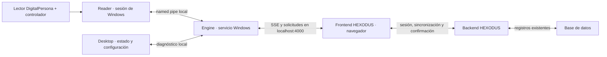

# HEXODUS BioSync — motor local para Windows

Código fuente del motor de huellas que se instala junto a HEXODUS. La versión incluida es **2.2.1**, usa el protocolo biométrico v1 y entrega eventos al frontend mediante **SSE** en `http://localhost:4000`. Este repositorio contiene el servicio, el auxiliar del lector, la interfaz, el instalador y las pruebas. **No contiene el instalador compilado, claves reales, huellas, datos de socios ni configuraciones de una PC.**

## Para qué sirve

El navegador no accede directamente al lector DigitalPersona. BioSync escucha el lector en la computadora del gimnasio, compara la captura con una caché local de las huellas autorizadas y entrega el resultado a la pantalla de asistencia. El backend decide y registra la asistencia; una coincidencia local por sí sola no concede acceso. La misma instalación permite enrolar huellas desde el formulario de socios. El lector y su controlador pueden conectarse después de instalar BioSync.

## Arquitectura



| Carpeta | Función |
| --- | --- |
| `MotorLocalExus/Engine` | Servicio Windows: endpoints locales, caché, comparación, SSE, firma, cola durable y diagnóstico. |
| `MotorLocalExus/Reader` | Proceso de la sesión interactiva que usa el SDK USB DigitalPersona; se reconecta al servicio. |
| `MotorLocalExus/Desktop` | Ventana para configurar el origen del frontend, la terminal y la clave; muestra estado y logs. Cerrarla no detiene el servicio. |
| `MotorLocalExus/Shared` | Contratos locales, almacenamiento protegido con DPAPI y permisos de archivos. |
| `MotorLocalExus/Installer` | Proyecto Inno Setup: instala servicio, auxiliar, accesos directos, inicio automático y desinstalación. |
| `MotorLocalExus/Tests` | Pruebas de protocolo, SSE, cola y empaquetado con archivos temporales. |
| `tools/compilar-motor-exus.ps1` | Publica los tres proyectos para `win-x64` y crea el instalador. |

### Flujo de asistencia

1. El usuario autorizado abre la pantalla de asistencia. El frontend solicita al backend una sesión temporal y sincroniza las huellas vigentes con el motor.
2. El frontend mantiene una conexión SSE autorizada con el servicio local. El detector espera una huella; cuando la obtiene, el motor compara contra su caché y conserva el evento en la cola local.
3. El frontend envía el evento firmado al backend. El backend valida la sesión, la membresía y los permisos, y registra el resultado de forma idempotente.
4. Solo después de recibir el comprobante del backend, el frontend confirma el evento al motor. Si hay un corte, el evento sigue pendiente y se reintenta sin duplicar la asistencia.
5. El enrolamiento de socios usa una captura autorizada independiente; el acceso al lector se coordina con el detector continuo para evitar lecturas simultáneas.

El motor no consulta continuamente al backend por socios: la pantalla sincroniza la caché al abrirse y al cambiar una huella. No crea socios ficticios ni modifica el esquema de la base de datos.

La sesión SSE del kiosco dura hasta ocho horas. Su vencimiento requiere una nueva autorización del backend; la sesión para enrolar huellas conserva el límite de diez minutos. Instala el motor 2.2.1 antes de desplegar el backend que emite las sesiones de ocho horas, porque versiones anteriores del motor rechazan su duración.

## Compilar el instalador desde una copia nueva

Se necesita **Windows 11 x64**, **SDK de .NET 8**, **Inno Setup 6** (`ISCC.exe`) y el **SDK DigitalPersona** que contiene `DPUruNet.dll`. La DLL y el controlador del lector son del proveedor; este repositorio público no redistribuye el SDK. Solicita el SDK por el [centro de desarrollo de HID](https://sdk.hidglobal.com/node/34864) y revisa sus [términos de uso](https://www.hidglobal.com/sales-policy/sdk-license-agreement). El driver del lector se instala por separado en la PC de destino.

Desde la raíz del repositorio, en PowerShell:

```powershell
powershell -NoProfile -ExecutionPolicy Bypass -File .\tools\compilar-motor-exus.ps1 `
  -DPUruNetDll 'C:\ruta\del\SDK\DPUruNet.dll'
```

El script busca `dotnet.exe` e `ISCC.exe` en `PATH` o en las ubicaciones habituales de Inno Setup. Si están en otro lugar, agrega `-DotnetPath 'C:\ruta\dotnet.exe'` y `-InnoCompiler 'C:\ruta\ISCC.exe'`. También admite una DLL previamente copiada a `MotorLocalExus/Engine/DPUruNet.dll`; esa ruta está ignorada por Git.

El proceso ejecuta `dotnet publish` para **Service**, **Reader** y **Desktop** en `Release`, `win-x64` y `--self-contained true`; después Inno Setup empaqueta los tres. Se generan localmente:

```text
artifacts/HEXODUS-BioSync-Setup.exe
artifacts/HEXODUS-BioSync-Setup.sha256
```

`artifacts/`, `.build/`, `bin/` y `obj/` están excluidos de Git. El instalador incluye el runtime .NET; la PC cliente no necesita el SDK de .NET ni Inno Setup. El archivo SHA-256 permite comprobar integridad, **no sustituye una firma digital**.

### Pruebas antes de distribuir

Con `DPUruNet.dll` ya colocada en `MotorLocalExus/Engine`, ejecuta desde la raíz:

```powershell
dotnet run --project .\MotorLocalExus\Tests\Protocol\Protocol.csproj -c Release
dotnet run --project .\MotorLocalExus\Tests\Sse\Sse.csproj -c Release
dotnet run --project .\MotorLocalExus\Tests\QueueIo\QueueIo.csproj -c Release
dotnet run --project .\MotorLocalExus\Tests\Packaging\Packaging.csproj -c Release
```

Estas pruebas usan datos y carpetas temporales; no conectan con Supabase ni registran asistencias reales. La prueba completa del lector requiere Windows, el driver y un dispositivo físico.

## Configuración e instalación en la PC

1. Ejecuta `HEXODUS-BioSync-Setup.exe` como administrador. La elevación instala el servicio y se solicita una vez, no en cada arranque.
2. La comprobación del lector es opcional: puedes omitirla si aún no tienes el USB o su controlador.
3. En la ventana inicial escribe el **origen exacto del frontend**, por ejemplo `https://tu-dominio.example` o `http://localhost:3000`, **sin** `/asistencia/huella`, `/login` ni barra final.
4. Escribe el identificador de la terminal, por ejemplo `KIOSKO-HUELLA-01`, y su clave de comunicación en Base64. La clave debe corresponder al mismo identificador en `BIOMETRIC_DEVICE_KEYS` del backend. No es una contraseña de Supabase.
5. Pulsa **Guardar e iniciar motor**. Abre la pantalla de asistencia con un usuario autorizado. La ventana de BioSync mostrará si el servicio, el lector, la pantalla SSE y la caché están listos.

**Ejemplo de formato, sin credenciales reales:**

```text
Frontend: https://tu-dominio.example
Terminal: KIOSKO-HUELLA-01
Clave del motor: <BASE64_DE_32_BYTES_ALEATORIOS>
Backend BIOMETRIC_DEVICE_KEYS: {"KIOSKO-HUELLA-01":"<MISMA_CLAVE_BASE64>"}
```

La clave se genera fuera del repositorio y se guarda en la configuración protegida de la máquina y en el backend autorizado. Para generar una nueva clave de 32 bytes en PowerShell:

```powershell
[Convert]::ToBase64String([Security.Cryptography.RandomNumberGenerator]::GetBytes(32))
```

No pegues esa clave en el frontend, en `NEXT_PUBLIC_*`, en el código ni en Git. El frontend usa `NEXT_PUBLIC_MOTOR_URL=http://localhost:4000`, `NEXT_PUBLIC_MOTOR_TRANSPORT=sse` y un `NEXT_PUBLIC_KIOSK_ID` que coincida con la terminal configurada. Cada frontend de producción requiere su origen exacto en BioSync. Un archivo `.exusconfig` cifrado es específico de la computadora que lo creó y no sirve como configuración universal.

El instalador usa `C:\Program Files\Motor Local Exus` para el programa y `C:\ProgramData\Motor Local Exus\private` para configuración, cola y logs protegidos. El servicio `MotorLocalExus` se inicia con Windows bajo `LocalService`, con recuperación tras fallos; el auxiliar del lector se inicia en la sesión del usuario. La interfaz se puede cerrar sin detener el motor. La desinstalación elimina los componentes y datos locales, y pide confirmación si hay eventos pendientes; no borra datos del backend ni el driver del lector.

## Firma y distribución

Sin firma, Windows Smart App Control o SmartScreen pueden advertir o bloquear el instalador. El script acepta opcionalmente `-SignToolPath`, `-ArtifactSigningDlib` y `-ArtifactSigningMetadata` para Microsoft Artifact Signing: firma los ejecutables antes de empaquetar y después firma el instalador. Los tres parámetros deben indicarse juntos. [`tools/configurar-firma-microsoft.sample.json`](tools/configurar-firma-microsoft.sample.json) contiene solo marcadores; coloca los metadatos reales **fuera del repositorio**. El certificado y la cuenta de firma deben pertenecer a quien distribuye el producto.

## Diagnóstico y seguridad

- `http://localhost:4000/estado` informa estado local; `/eventos/stream` mantiene SSE. El servicio escucha únicamente en loopback y limita CORS a los orígenes configurados.
- Si el motor está activo pero el frontend no conecta, verifica el origen exacto, el identificador, la clave correspondiente del backend y el estado de la sesión autorizada.
- Si la pantalla conecta pero el lector no, revisa el driver DigitalPersona, el USB y el auxiliar interactivo. El motor puede seguir instalado sin lector.
- Si la caché aparece vacía, revisa la sesión, el backend y la sincronización antes de probar una huella.
- La cola de eventos persiste hasta la confirmación del backend. No borres `ProgramData` para resolver una desconexión: podrías perder eventos pendientes.
- Los logs y diagnósticos no deben contener plantillas de huella ni claves. La configuración se cifra con DPAPI y se restringe a cuentas locales autorizadas.

El código de esta entrega no incluye claves reales, archivos `.env`, plantillas, bases de datos ni binarios compilados del motor. El SDK de HID es una dependencia externa, y el acceso al backend y al frontend se configura para cada despliegue.
